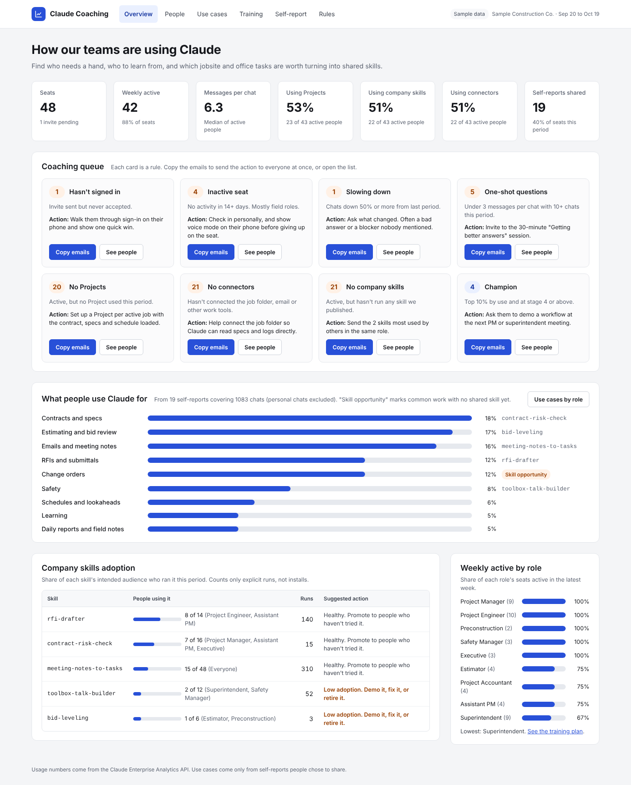
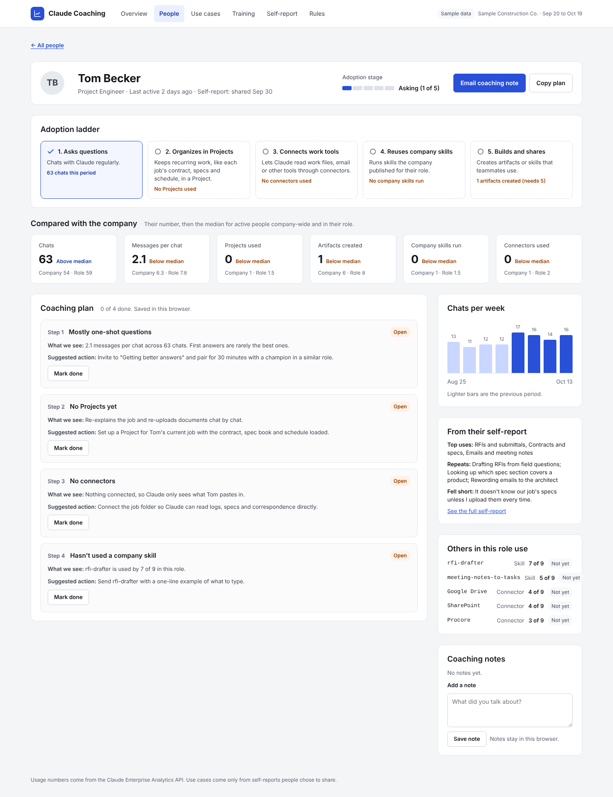
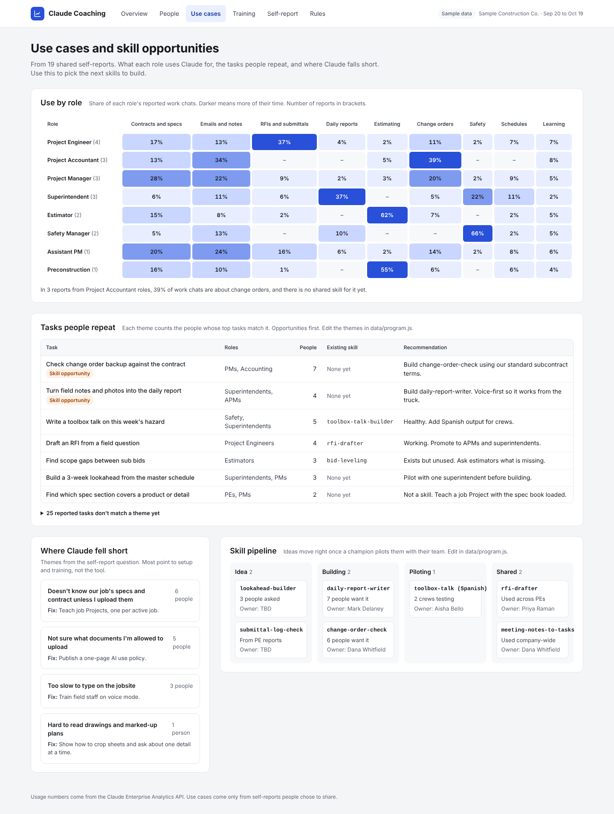

# Claude Organization Dashboard

A coaching dashboard for organizations rolling out Claude. It shows who is getting value, who needs a hand, and which everyday tasks are worth turning into shared skills, so the money you spend on seats turns into real adoption.

It is a single static page (HTML, CSS and plain JavaScript with no build step and no dependencies) that runs from a folder, an internal web server or GitHub Pages.



## What it shows

| Tab | What you get |
|---|---|
| **Overview** | Seats, weekly active people, messages per chat, and adoption of Projects, company skills and connectors. A coaching queue groups people by rule (inactive, one-shot questions, no Projects, no connectors, no company skills, champions), and each card copies the right email list in one click. Also shows what people use Claude for, adoption of each company skill, and weekly activity by role. |
| **People** | Everyone with a seat, with sortable columns, filters, search, adoption stage and coaching flags. Export to CSV or copy emails for any filter. |
| **Person drill-down** | A five-step adoption ladder, the person's numbers next to company and role medians, a coaching plan built from their flags (mark steps done, email the plan to them), weekly trend, what others in the role use, their self-report, and private coaching notes. |
| **Use cases** | A role-by-category heat map, repeated tasks matched to skill opportunities, themes from "where did Claude fall short", and a skill pipeline from idea to shared. |
| **Training** | Cohorts by adoption stage with the next session for each, role tracks with champions, and upcoming sessions. |
| **Self-report** | A preview of what each person sees when they run the opt-in self-report skill, and the exact row it shares. |
| **Rules** | Every rule, its threshold, the Analytics API field it comes from, and the suggested action. |



## Try it

Download or clone the repository and open `index.html` in a browser. It starts with sample data for a fictional 48-person construction company.

```bash
git clone https://github.com/marcus-erickson/ClaudeOrganizationDashboard.git
cd ClaudeOrganizationDashboard
open index.html        # macOS. On Windows: start index.html
```

To host it, turn on GitHub Pages for your copy (Settings > Pages > Deploy from branch > `main` / root). Only do that with sample data. Your real data contains names and should stay internal (see [Privacy](#privacy)).

## Where the data comes from

The dashboard combines two sources:

1. **Usage numbers** from the [Claude Enterprise Analytics API](https://platform.claude.com/docs/en/manage-claude/analytics-api): chats, messages, Projects, artifacts, files, company skill runs, connectors and last active date for each person. These are counts only. The API never returns chat content.
2. **Use cases** from an opt-in **self-report**. Each person runs the [`claude-self-report`](skills/claude-self-report/SKILL.md) skill, sees a summary of their own month (work categories, features used, top repeated tasks, one "where Claude fell short" answer) and decides whether to add it to a shared Google Sheet. Chat titles, content and names are never included.



`scripts/build-data.mjs` pulls both into `data/live-data.js`, and the dashboard picks that file up automatically. See **[docs/SETUP.md](docs/SETUP.md)** for the step-by-step guide.

You need a Claude Enterprise plan for the Analytics API, and the Primary Owner has to create the API key.

## Make it yours

Everything specific to an organization or industry lives in two files, so you never need to touch `app.js`:

- **`config.js`**: organization name, the work categories people report against, your company skills and who they're for, and every coaching threshold.
- **`data/program.js`**: the wording of each coaching action, repeated-task themes to watch for, training tracks, champions, sessions and the skill pipeline.

The sample is set up for construction (PMs, superintendents, RFIs, daily reports). **[docs/CUSTOMIZE.md](docs/CUSTOMIZE.md)** shows how to switch it to a law firm, a healthcare group, an agency or a general office.

## Project layout

```
index.html                  The page
styles.css                  Styles (light and dark)
app.js                      All logic: metrics, flags, stages, views
config.js                   Your categories, skills and thresholds
data/program.js             Your coaching wording, themes, training and pipeline
data/sample-data.js         Fictional sample organization
data/live-data.js           Your real data (generated, git-ignored)
data/*.example.csv          Example roster and self-report sheet
scripts/build-data.mjs      Builds live-data.js from the Analytics API
skills/claude-self-report/  The opt-in self-report skill
docs/                       Setup and customization guides
```

## Privacy

- The dashboard holds names and usage numbers for your people. `data/live-data.js`, `data/roster.csv` and `data/self-reports.csv` are in `.gitignore` so they don't end up in a public repository. Host the live version somewhere only coaches and managers can reach.
- Use-case detail only exists for people who choose to share a self-report.
- Coaching notes and "mark done" progress are saved in the viewer's own browser (local storage), not on any server.
- Tell people what is tracked and why before you launch. Coaching lands better when nobody feels watched.

## Contributing

Ideas and pull requests are welcome, especially industry presets for `config.js` and `data/program.js`, and corrections as the Analytics API evolves.

## License

[MIT](LICENSE)
