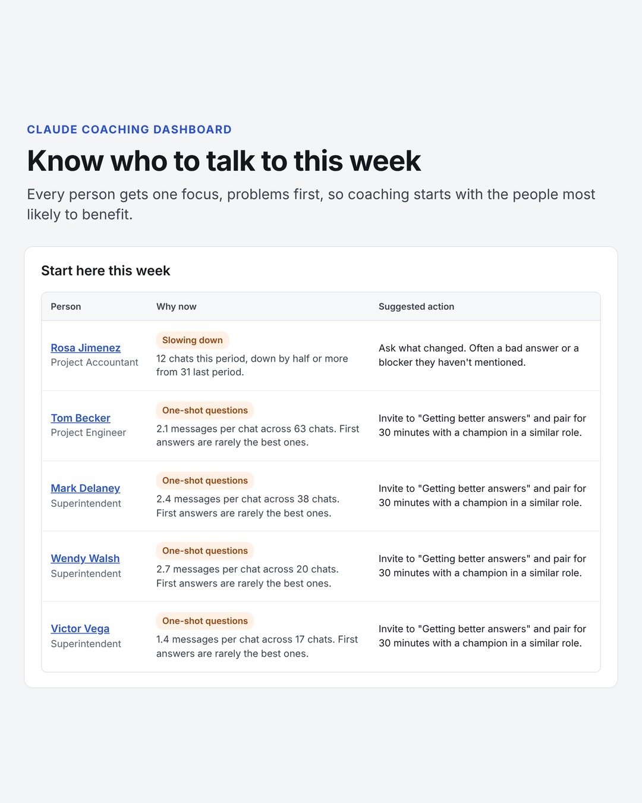
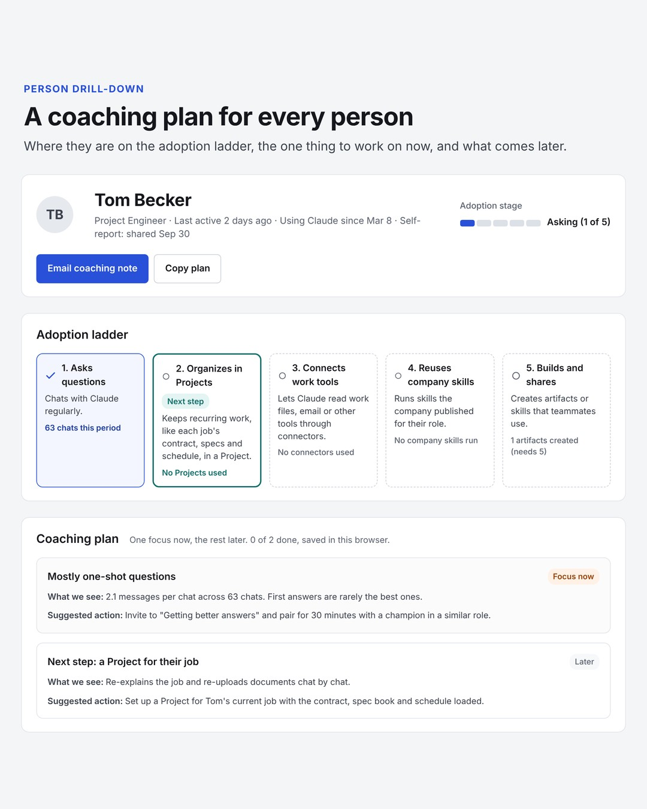
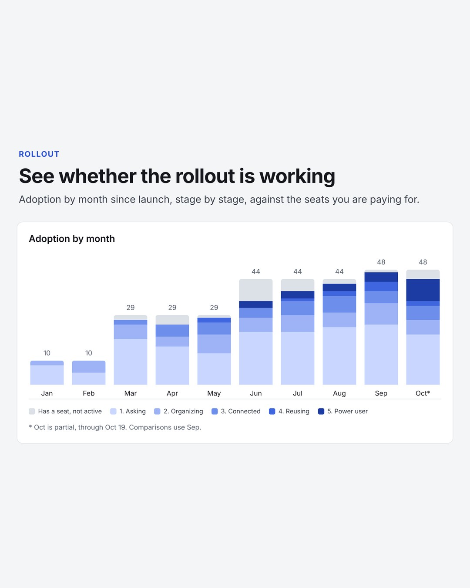
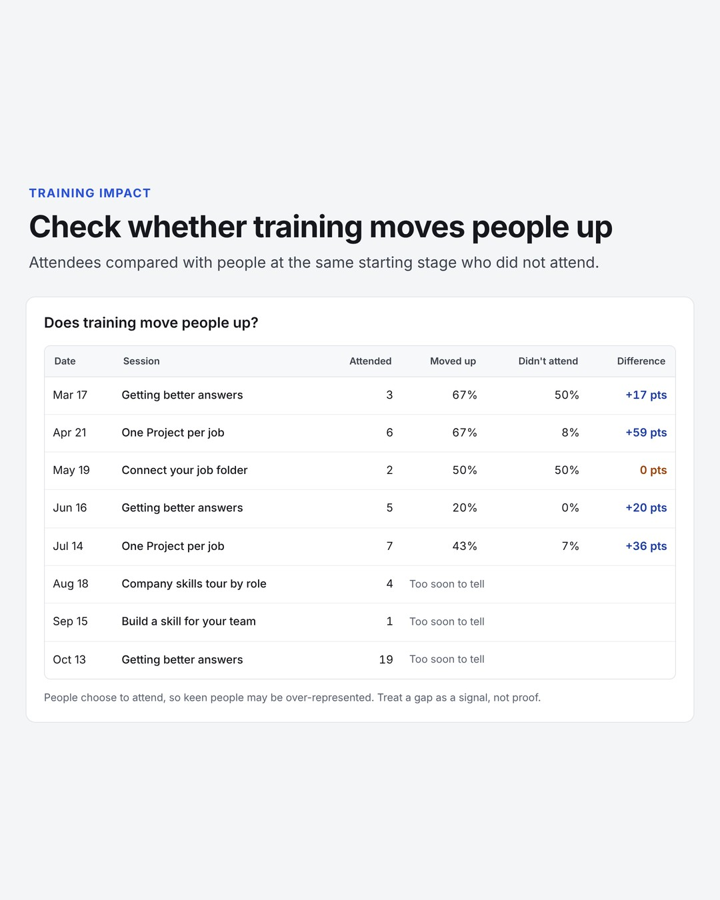
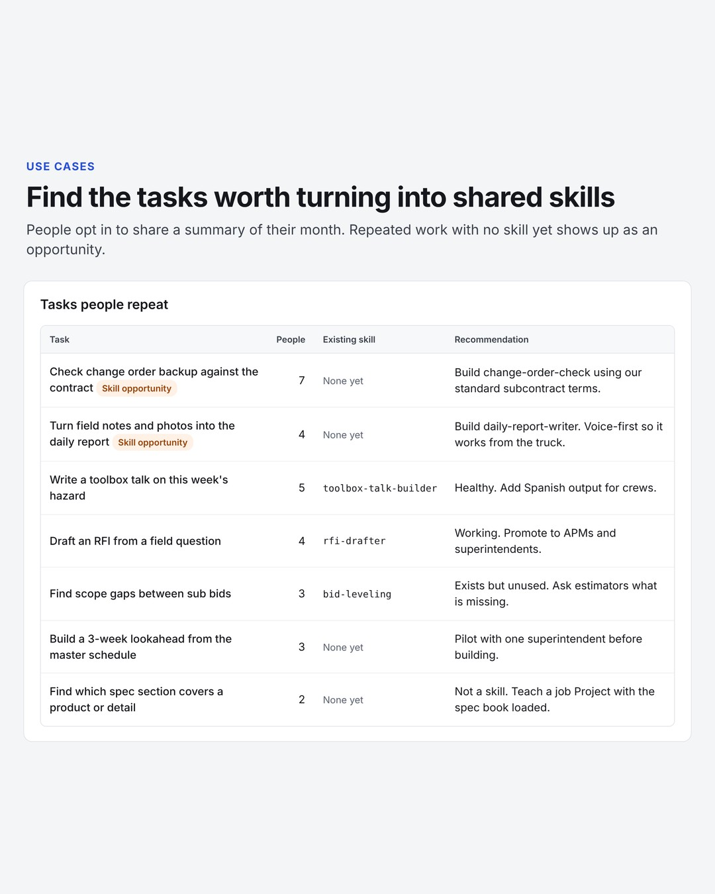
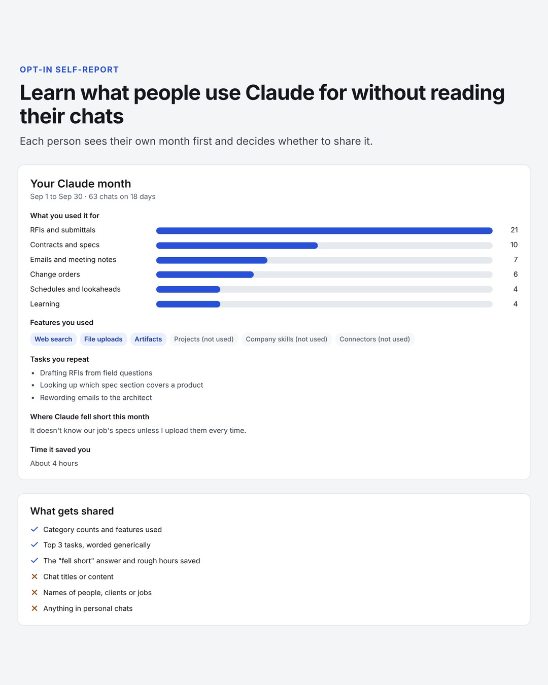

# Claude Organization Dashboard

A coaching dashboard for organizations rolling out Claude. It shows who is getting value, who needs a hand, and which everyday tasks are worth turning into shared skills, so the money you spend on seats turns into real adoption.

It is a single static page (HTML, CSS and plain JavaScript with no build step and no dependencies) that runs from a folder, an internal web server or GitHub Pages.

> **Status: early release.** The dashboard is tested end to end with the sample data. The data script (`scripts/build-data.mjs`) follows Anthropic's [Analytics API reference](https://platform.claude.com/docs/en/api/beta/organization/analytics) and has been tested against a mock of that API, but not yet against a live Claude Enterprise organization. It prints a short list of checks at the end of every run. If you try it on your organization, please [open an issue](https://github.com/marcus-erickson/ClaudeOrganizationDashboard/issues) with what you see, especially any check marked `!`.

<table>
  <tr>
    <td width="33%"></td>
    <td width="33%"></td>
    <td width="33%"></td>
  </tr>
  <tr>
    <td></td>
    <td></td>
    <td></td>
  </tr>
</table>

<sub>All screenshots use the fictional sample organization included in the repository.</sub>

## What it shows

| Tab | What you get |
|---|---|
| **Overview** | Seats, weekly active people, messages per chat, and adoption of Projects, company skills and connectors. "Start here this week" names the few people most worth a conversation. The coaching queue gives everyone one focus: a problem to fix first (slowing down, one-shot questions, inactive, never signed in), or else the next rung on the adoption ladder. Each card copies the right email list in one click. Also shows what people use Claude for, adoption of each company skill, and weekly activity by role. |
| **Rollout** | Whether the rollout is working: adoption by month against seats, stage by stage since launch, days from seat to first use, whether people stick with it (by the month they started), whether training sessions move people up a stage compared with people who didn't attend, and self-reported hours saved. |
| **People** | Everyone with a seat, with sortable columns, filters, search, adoption stage and their current focus. Export to CSV or copy emails for any filter. |
| **Person drill-down** | A five-step adoption ladder with the next step highlighted, the person's numbers next to company and role medians, a coaching plan with one focus now and the rest later (mark steps done, email the plan to them), weekly trend, what others in the role use, their self-report, and private coaching notes. |
| **Use cases** | A role-by-category heat map, repeated tasks matched to skill opportunities, themes from "where did Claude fall short", and a skill pipeline from idea to shared. |
| **Training** | Cohorts by adoption stage with the next session for each, role tracks with champions, and upcoming sessions. |
| **Self-report** | A preview of what each person sees when they run the opt-in self-report skill, and the exact row it shares. |
| **Rules** | Every rule, its threshold, the Analytics API field it comes from, and the suggested action. |


## Try it

Download or clone the repository and open `index.html` in a browser. It starts with sample data for a fictional 48-person construction company.

```bash
git clone https://github.com/marcus-erickson/ClaudeOrganizationDashboard.git
cd ClaudeOrganizationDashboard
open index.html        # macOS. On Windows: start index.html
```

To host it, turn on GitHub Pages for your copy (Settings > Pages > Deploy from branch > `main` / root). Only do that with sample data. Your real data contains names and should stay internal (see [Privacy](#privacy)).

## Set it up for your organization

**Who you need:** one person to own the rollout (an AI lead or champion), your Claude **Primary Owner** for about five minutes to create the API key, and someone comfortable running a Node.js script. Plan on an afternoon the first time. Most of it goes to step 3.

1. **Try the sample.** Open `index.html` and click through every tab so you know what you're setting up. *(10 minutes, anyone)*
2. **Make a private copy.** Clone this repository into a private repo or an internal folder. Your live data will contain names, so don't build it inside a public fork. *(AI lead)*
3. **Adapt it to your organization.** In `config.js`, set your organization name, the 8 to 10 work categories people will report against, your company skills and who each one is for, and the coaching thresholds. In `data/program.js`, rewrite the coaching wording, repeated-task themes, role tracks and champions. See [docs/CUSTOMIZE.md](docs/CUSTOMIZE.md), which includes starter category lists for law, healthcare, agencies and general offices. *(AI lead)*
4. **Create an Analytics API key** with the `read:analytics` scope at claude.ai > Organization settings > API. Requires Claude Enterprise. See [SETUP step 1](docs/SETUP.md#1-create-an-analytics-api-key). *(Primary Owner)*
5. **Build the roster.** Copy `data/roster.example.csv` to `data/roster.csv` and list everyone with a seat: email, name, role, the date they got the seat, and `pending` for unaccepted invites. If you run training sessions, start an attendance list too (`data/attendance.example.csv`). Use the same role names as in step 3. See [SETUP step 2](docs/SETUP.md#2-make-the-roster). *(AI lead or IT)*
6. **Roll out the self-report** (optional, recommended). Create the shared Google Sheet and paste its URL and your category list into [`skills/claude-self-report/SKILL.md`](skills/claude-self-report/SKILL.md). Zip the `claude-self-report` folder, test it under **Customize > Skills > + > Create skill > Upload a skill**, then have an Owner add it for everyone under **Organization settings > Plugins & skills > Add > Upload a skill**. See [Installing the self-report skill](docs/SETUP.md#installing-the-self-report-skill). *(AI lead and an Owner)*
7. **Build the live data and host it internally.** Set `launchDate` in `config.js`, then run `node scripts/build-data.mjs --roster data/roster.csv --reports data/self-reports.csv --attendance data/attendance.csv` (the last two are optional). Check that the header says **Live data**, and put the folder somewhere only coaches and managers can open. Schedule the script to run nightly. See [SETUP steps 5 and 6](docs/SETUP.md#5-build-the-data). *(Whoever runs scripts)*
8. **Launch.** Tell everyone what is tracked and why, ask managers to have people run the self-report at their first one-on-one of the month, and hold a monthly review of the coaching queue and skill opportunities. *(AI lead and managers)*

## Where the data comes from

The dashboard combines two sources:

1. **Usage numbers** from the [Claude Enterprise Analytics API](https://platform.claude.com/docs/en/manage-claude/analytics-api): chats, messages, Projects, artifacts, files, company skill runs, connectors and last active date for each person. These are counts only. The API never returns chat content.
2. **Use cases** from an opt-in **self-report**. Each person runs the [`claude-self-report`](skills/claude-self-report/SKILL.md) skill, sees a summary of their own month (work categories, features used, top repeated tasks, one "where Claude fell short" answer) and decides whether to add it to a shared Google Sheet. Chat titles, content and names are never included.


`scripts/build-data.mjs` pulls both into `data/live-data.js`, and the dashboard picks that file up automatically. [docs/SETUP.md](docs/SETUP.md) covers the details, including the data file format if you want to feed it from your own warehouse instead.

You need a Claude Enterprise plan for the Analytics API, and the Primary Owner has to create the API key.

## Make it yours

Everything specific to an organization or industry lives in two files, so you never need to touch `app.js`:

- **`config.js`**: organization name, the work categories people report against, your company skills and who they're for, and every coaching threshold.
- **`data/program.js`**: the wording of each coaching action, repeated-task themes to watch for, training tracks, champions, sessions and the skill pipeline.

The sample is set up for construction (PMs, superintendents, RFIs, daily reports). **[docs/CUSTOMIZE.md](docs/CUSTOMIZE.md)** shows how to switch it to a law firm, a healthcare group, an agency or a general office.

## Project layout

```
index.html                  The page
styles.css                  Styles (light and dark)
app.js                      All logic: metrics, flags, stages, views
config.js                   Your categories, skills and thresholds
data/program.js             Your coaching wording, themes, training and pipeline
data/sample-data.js         Fictional sample organization
data/live-data.js           Your real data (generated, git-ignored)
data/*.example.csv          Example roster, self-report sheet and training attendance
scripts/build-data.mjs      Builds live-data.js from the Analytics API
skills/claude-self-report/  The opt-in self-report skill
docs/                       Setup and customization guides
```

## Privacy

- The dashboard holds names and usage numbers for your people. `data/live-data.js`, `data/roster.csv` and `data/self-reports.csv` are in `.gitignore` so they don't end up in a public repository. Host the live version somewhere only coaches and managers can reach.
- Use-case detail only exists for people who choose to share a self-report.
- Coaching notes and "mark done" progress are saved in the viewer's own browser (local storage), not on any server.
- Tell people what is tracked and why before you launch. Coaching lands better when nobody feels watched.

## Contributing

Ideas and pull requests are welcome, especially industry presets for `config.js` and `data/program.js`, and corrections as the Analytics API evolves.

## License

[MIT](LICENSE)
